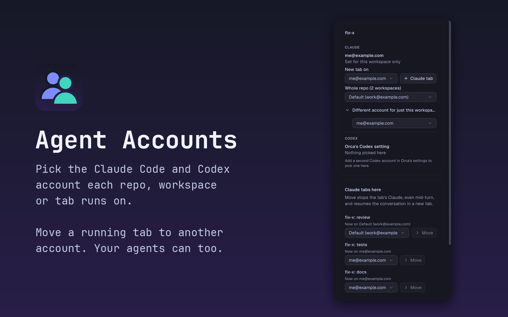

# Agent Accounts (Orca plugin)



Pick which Claude Code and Codex account your agents in [Orca](https://github.com/stablyai/orca)
run on: per repo, per workspace, or per tab. Work repos on your work login, side projects on your
personal one, with no `.envrc` or other file in the worktree. Your agents can do the same through
the `orca` CLI.

**macOS only.** Claude tested live on Orca 1.4.255. **Codex support is experimental**: it has not
been tested end to end with a real second Codex account. This is a community plugin: the Orca
plugin directory shows it as "Community · unreviewed", meaning it passed the directory's automatic
checks but nobody at Orca has reviewed it.

- [Install](#install)
- [Use it](#use-it)
- [Agent access](#agent-access)
- [How it works](#how-it-works)
- [Limits](#limits)
- [Troubleshooting](#troubleshooting)
- [Develop](#develop)

## Install

1. Add your accounts in Orca's settings first, Claude and (if you use it) Codex. Orca handles
   sign-in; this plugin only chooses between the accounts Orca has.
2. Install:

   ```sh
   orca plugin install https://github.com/AnhVanGiang/orca-agent-accounts
   ```

3. Orca lists the access the plugin asks for and a fingerprint to approve:
   - its own storage;
   - reading your workspace list and the focused workspace's terminals;
   - starting agents in your workspaces (the **New tab** and **Move** buttons);
   - typing into your terminals (only to stop a Claude tab you move, and to type a starting prompt
     an agent passes to a new tab).
4. Open **Agent accounts** from the right sidebar, or click the plugin's item in the status bar.

Want your agents to use it too? Install it the way [Agent access](#agent-access) describes instead.

## Use it

Everything happens in the **Agent accounts** panel, for the workspace you have focused.

### Give a whole repo an account

Under **Claude** (or **Codex**), choose an account in **Whole repo**. Every worktree of that repo,
including ones created later, now starts new agent tabs on it. The repo is found from git, so
worktrees kept outside the repo folder count too. **Assign another repo** at the bottom of the
panel finds any other repo by name.

### Give one workspace a different account

Open **Different account for just this workspace** and choose one. It wins over the repo's choice
for this workspace only. Choose **Same as repo** to undo.

### Open one tab on another account

Choose an account in **New tab on**, then press **Claude tab** (or **Codex tab**). One agent tab
opens on that account; the repo's and workspace's choices stay as they were. The tab opens in the
tab bar without taking focus. Orca's own **+** button cannot show a picker (Orca gives plugins no
way to add one), so a **+** tab follows the repo or workspace choice.

### Move a running Claude tab to another account

The **Claude tabs here** card lists every Claude tab in the focused workspace and the account it
is on. Choose another account and press **Move**. The plugin:

1. stops that tab's Claude right away with Ctrl+C (a turn in progress is cut off), or with SIGTERM
   if it is still running after about 12 seconds;
2. opens a new tab on the chosen account that continues the same conversation, with its full
   history;
3. closes the old tab.

If the new tab does not start Claude within 15 seconds, the old tab stays open and the error
shows the `claude --resume <id>` command that continues the conversation by hand. Moving works for Claude tabs only.

### See which account your tabs use

The status bar item shows the account of every Claude tab in the focused workspace, for example
`Claude: me ×2 · default`. Hover it for each tab by name, and for the account new tabs start on.
Orca does not tell plugins which tab is focused, so it lists all of them. With no Claude tabs
running it shows the workspace's choice for new tabs (`Claude: me@example.com`, or
`Accounts: default`). It updates when tabs open or close, and at least every 20 seconds.

### Folder trust

Leave **Trust workspaces for picked Claude accounts** on unless you rely on Claude's trust prompt.
With an account selected in Orca's own Claude switcher, Orca marks a new folder trusted in that
account only, so the account you picked here would stop at Claude's trust prompt in every new
worktree. The plugin writes the same trust record into the picked account at launch (never for
your home folder or above). It cannot read Orca's trust settings, so it also does this for repos
set to "let agents ask" and when Orca's workspace trust is off.

## Agent access

Agents use the plugin through `orca plugin dev request local.agent-accounts <handler>`. They can
list every Claude tab and its account, open a Claude or Codex tab on an account with a starting
prompt, move any Claude tab (their own included) to another account, and set a repo's or
workspace's account.

Orca only lets the CLI call a plugin loaded from a folder, not one installed from a catalog or
Git. To give agents access, load a clone instead of installing:

```sh
orca plugin list | grep agent-accounts          # installed before? note its key, then:
orca plugin uninstall <that key>
git clone https://github.com/AnhVanGiang/orca-agent-accounts ~/orca-agent-accounts
orca plugin dev load ~/orca-agent-accounts      # approve with the fingerprint it prints
```

Update later with `git -C ~/orca-agent-accounts pull`; Orca reloads it. An update that asks for
new access needs `orca plugin dev reload ~/orca-agent-accounts --approve <fingerprint>`.

Then give your agents the agent manual,
[skills/orca-agent-accounts/SKILL.md](skills/orca-agent-accounts/SKILL.md). It is a Claude Code
skill: link it into your skills folder and Claude picks it up when you ask for another account:

```sh
ln -s ~/orca-agent-accounts/skills/orca-agent-accounts ~/.claude/skills/orca-agent-accounts
```

Any process running as you can call these handlers, the same as the `orca` CLI itself.

## How it works

- Accounts are Orca's own: Claude accounts under `claude-profiles/<id>/home`, Codex accounts under
  `codex-accounts/<id>/home` in Orca's data folder.
- When Orca's launcher starts `claude`, `claude-agent-teams` or `codex` in a terminal, the plugin's
  `agent.launch.before` hook prefixes the command with `CLAUDE_CONFIG_DIR='<home>'` or
  `CODEX_HOME='<home>'`. A command-line assignment wins even over an account selected in Orca's
  own switcher (Orca applies its env earlier).
- A missing or signed-out account blocks the launch with a message instead of starting on the
  wrong account.
- **New tab** and **Move** set a one-time choice for the next launch in that workspace, then ask
  Orca to start the agent; the hook uses that choice instead of the repo's, once.
- **Move** finds the tab's Claude by the tab handle Orca puts in its environment, and its
  conversation in `sessions/<pid>.json` in the account folder. The new tab runs
  `claude --resume <id> --fork-session`: Orca starts every Claude tab with its own `--session-id`,
  which Claude accepts together with `--resume` only as a fork. The fork keeps the whole history,
  and Orca keeps tracking the new tab. Orca's Claude accounts share `~/.claude/projects`, so every
  account finds the conversation.
- Trust records use Orca's file format and locking; ported from
  [Claude Pin](https://github.com/tourbut/claude-pin) (MIT), a Claude-only plugin with the same idea.

[DESIGN.md](DESIGN.md) has each decision and why.

## Limits

Orca gives plugins no hook for these, so they use Orca's own account setting:

- chat (non-terminal) sessions;
- resumed sessions, and tabs Orca restores after a restart (a moved tab included);
- `orca terminal create --command "claude ..."` and agents typed into a plain shell;
- workspaces on another host (SSH, WSL).

Also:

- Orca's **+** button follows the repo or workspace choice; per-tab picks are in the panel.
- The status bar cannot follow the focused tab; it lists all Claude tabs of the workspace.
- Codex tabs cannot be moved; open a new Codex tab instead.
- Moving cuts off a turn in progress and stops anything that Claude was running (background
  shells, subagents).
- Claude Agent Teams follows the plugin only while Orca's own Claude account is set to System
  default (its teammate panes get Orca's env).
- If the plugin crashes, launches continue on the default account (`onError: pass`), so
  automations never stop.
- Not tested live: a launch with an account selected in Orca's own switcher (checked against
  Orca's real shell function only), Codex with a second real account, and a starting prompt for a
  Codex tab (typed after a fixed 4 s wait).
- **Move** refuses a Claude that was started in a subfolder of the workspace: the new tab would
  open at the workspace root, where Claude may not find the conversation.
- Codex: Orca prepares only the Codex account selected in its own settings. For a different account
  chosen here, Orca skips its per-launch setup, so the first launch in a new folder may show Codex's
  trust prompt, Orca's agent status for that pane may stay blank, and the account's config and
  skills stay as they were the last time Orca's settings selected it.
- `/resume` in a Codex pane finds older sessions only when Orca's "share history across accounts"
  setting is on and Orca has bridged that account's history.
- The plugin log records workspace paths, account folders and session ids (local only).

## Troubleshooting

| Problem | Fix |
|---|---|
| Panel says "macOS only for now" | Not supported on this system |
| A launch is refused: "account … is signed out" | Sign in to that account in Orca's settings, or pick another |
| A tab started on the wrong account | It was a chat, a restored tab, or started with `orca terminal create --command`; see [Limits](#limits). Use **Move** |
| **Move** says "The old Claude would not stop" | Nothing else changed. Quit that Claude by hand, then use **New tab on** |
| **Move** failed after stopping the old Claude | Run the `claude --resume <id>` command from the error in a tab on the account you want |
| Nothing happens at all | `orca plugin list` should show `agent-accounts … running`; `orca plugin logs <key>` shows what it did |

## Develop

```sh
orca plugin types .      # creates .orca/types, which tsconfig.json extends
orca plugin validate .
orca plugin check .      # renders each panel scenario in src/panel.check.ts
orca plugin test .       # worker/main.test.ts
orca plugin dev load .
```

[AGENTS.md](AGENTS.md) has the layout and the live checks for contributors, human or agent.

## License

MIT. `worker/trust.ts` follows Orca's `claude-folder-trust-file.ts` as ported by Claude Pin (MIT,
tourbut).
